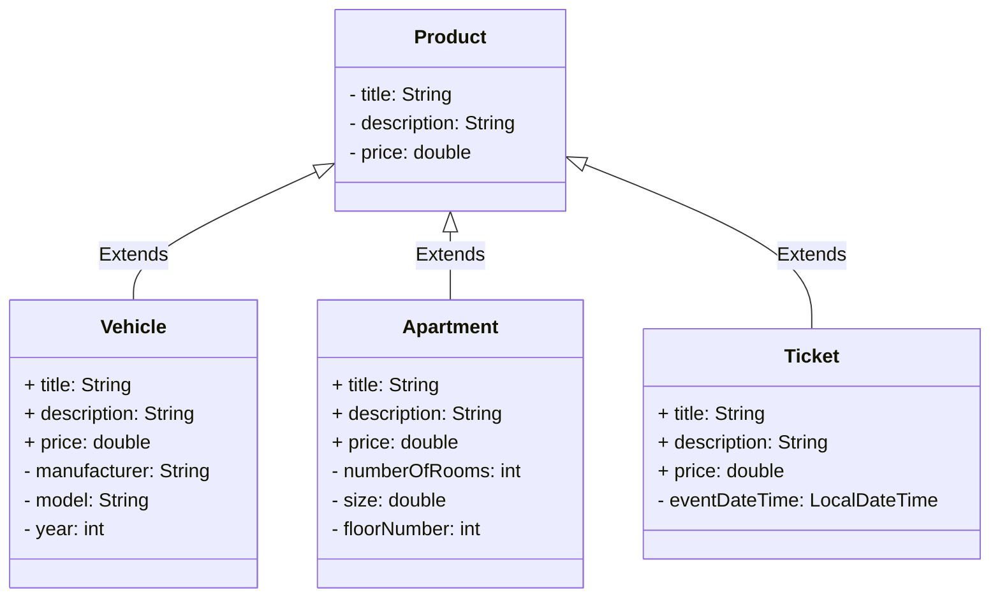

# Inheritance and interfaces


This repository contains Java exercises for learning inheritance and interfaces. We recommend the following self-study materials, and you should also look for information in other sources on your own:

* [Objects, Classes, Interfaces, Packages, and Inheritance (dev.java)](https://dev.java/learn/oop/)
* [Java Polymorphism Fully Explained In 7 Minutes (Coding with John, YouTube)](https://youtu.be/jhDUxynEQRI)
* [Super Keyword in Java Full Tutorial - How to Use "super" (Coding with John, YouTube)](https://www.youtube.com/watch?v=Qb_NUn0TSAU)

## Starting the exercise

First fork this repository into your own GitHub repository with GitHub's **Fork** button, and only then clone your fork to your computer:

```sh
git clone https://github.com/<your-github-username>/5-inheritance-and-interfaces.git
```

Open the cloned project in your code editor.

## Testing

The parts of the exercise have ready-made [JUnit](https://junit.org/) unit tests in the [src/test/java](./src/test/java/) directory. Each part tells which test class grades it. You can run the tests with your code editor's testing tool ([VS Code](https://code.visualstudio.com/docs/java/java-testing), [Eclipse](https://www.vogella.com/tutorials/JUnitEclipse/article.html)) or with [Gradle](https://docs.gradle.org/current/userguide/java_testing.html), for example:

```
./gradlew test --tests ProductTest        # unix
.\gradlew.bat test --tests ProductTest    # windows
```

Add `--info` to the end of the command for more details about failing tests. You do not need to study how the tests are implemented, and you can also try your solution with your own `main` method. You may write more tests of your own, but do not change or remove the given tests.

Do not change the names, parameters or return types of the given classes, methods and constructors, because the tests will then not compile. You get the original version of a file back with `git restore <path to file>` or with the **Palauta lähtökoodi** (restore starter code) function of the course system.

## Submitting and points

Each part of the exercise has its own page in the course system (https://jtjuslin.kapsi.fi/java), and its code fields contain the part's starter code. Copy your solution into the code fields or write it there directly. **Testaa ilman palautusta** (test without submitting) runs the part's tests without saving points, and **Lähetä** (submit) submits your solution. Each test class is accepted only if all of its tests pass, and the points are divided according to the accepted test classes.

**Points in two stages**

1. When your solution passes in the course system, you get **half of the points** for the part.
2. Finally, push everything to your public GitHub repository. Then press the **Lähetä tarkistettavaksi** (submit for checking) button on the part's page. When the tests pass, you get **full points** for the part. The repository may remain public.

There is no grading YAML workflow (GitHub Actions) on GitHub, and `git push` does not start any grading. When you press **Lähetä tarkistettavaksi**, the course system's bot fetches your code from your repository and checks it with the same tests. Both stages must be completed before the chapter deadline. You can submit as many times as you need, and your best result is kept.


## Part 1: inheritance *(basics, 10 % + 10 %)*

The four classes in the [inheritance.webshop](./src/main/java/inheritance/webshop/) package model the products of an imaginary web shop. All products have the data defined in the [Product](./src/main/java/inheritance/webshop/Product.java) class (title, description, price). [Vehicles](./src/main/java/inheritance/webshop/Vehicle.java), [apartments](./src/main/java/inheritance/webshop/Apartment.java) and [tickets](./src/main/java/inheritance/webshop/Ticket.java) have their own subclasses with additional data specific to them:



First implement the `Product` class according to its comments. When it works, implement the `Vehicle` class, which inherits `Product`. The `Apartment` and `Ticket` classes are so similar to `Vehicle` that they are not tested or graded: you can continue practicing inheritance with them on your own.

Graded with the test classes [ProductTest](./src/test/java/inheritance/webshop/ProductTest.java) (half of the points) and [VehicleTest](./src/test/java/inheritance/webshop/VehicleTest.java) (half of the points).


## Part 2: polymorphism *(applying, 20 %)*

Objects of subclasses can be used in place of objects of the superclass, for example in collections or as method parameters. Complete the methods of the [WebShop](./src/main/java/inheritance/webshop/WebShop.java) class, where you practice using objects of different types together and recognizing which class an object actually belongs to.

This part uses the `Product` and `Vehicle` classes you implemented in part 1, so first make sure they work. The course system brings them to this part automatically when you open it for the first time.

Graded with the test class [WebShopTest](./src/test/java/inheritance/webshop/WebShopTest.java).


## Part 3: the Comparable interface *(basics, 20 %)*

The [Country](./src/main/java/interfaces/country/Country.java) class models countries and their populations. Change the class to implement Java's ready-made [`Comparable<Country>`](https://docs.oracle.com/en/java/javase/21/docs/api/java.base/java/lang/Comparable.html) interface and implement its only method `compareTo` according to the rules in the class comments. You can try your solution with the ready-made [CountryMain](./src/main/java/interfaces/country/CountryMain.java) program.

Graded with the test class [CountryTest](./src/test/java/interfaces/country/CountryTest.java).


## Part 4: implementing your own interface *(applying, 10 % + 10 %)*

**The MarkdownExport interface.** Define your own interface `MarkdownExport` in the file [MarkdownExport.java](./src/main/java/interfaces/markdown/MarkdownExport.java) with one method: `exportMarkdown()`. The method takes no parameters and returns a string. The classes implementing the interface use it to create a [markdown](https://www.markdownguide.org/) representation of the object, for example to save it to a file. You do not need to know markdown syntax if you follow the examples below.

**The Pizza class.** Change the ready-made [Pizza](./src/main/java/interfaces/markdown/Pizza.java) class to implement the interface. The markdown representation of a pizza must contain the name as a heading (`# name`), the toppings as a list (`- topping`) and the price at the end, for example:

```md
# Hawaiian

Toppings:
- ham
- pineapple
- mozarella

Price: 10.90
```

**The Product class.** Finally, change the [Product](./src/main/java/inheritance/webshop/Product.java) class of part 1 to implement the interface. The markdown representation of a product must contain the name, the description and the price, but otherwise you can choose the format freely. Because `Product` is in a different package than the interface, add the line `import interfaces.markdown.MarkdownExport;` to it.

💡 *Because `Vehicle` inherits `Product`, it also implements the interface automatically. You may give vehicles their own `exportMarkdown` implementation.*

Graded with the test classes [MarkdownExportTest](./src/test/java/interfaces/markdown/MarkdownExportTest.java) (the interface and `Pizza`) and [ProductMarkdownTest](./src/test/java/interfaces/markdown/ProductMarkdownTest.java) (`Product`).


## Part 5: "dependency injection" *(advanced, 20 %)*

The last part is a "dependency injection" example that applies inheritance:

> *"In software engineering, dependency injection is a programming technique in which an object or function receives other objects or functions that it requires, as opposed to creating them internally. Dependency injection aims to separate the concerns of constructing objects and using them, leading to loosely coupled programs"*
>
> Dependency injection. Wikipedia. https://en.wikipedia.org/wiki/Dependency_injection

The solution only needs a small change. The most important thing is to study the given classes and their comments:

* [Main](./src/main/java/dependency_injection/Main.java): the assignment is in the comments of this class, and it is the only class you change.
* [Application](./src/main/java/dependency_injection/Application.java)
* [PrinterWithTimestamp](./src/main/java/dependency_injection/PrinterWithTimestamp.java)

Change the `Main` class so that it creates a `PrinterWithTimestamp` object, gives it to a new `Application` object and calls its `run()` method. Try the program by running the `Main` class in your code editor or with `./gradlew run` (on Windows `.\gradlew.bat run`) and study its output.

Graded with the test class `DependencyInjectionTest`, which runs the `Main` class and checks that every line of the application is printed with a timestamp. The test is not in this repository.


## License and authors

This exercise was developed by Teemu Havulinna and Jukka Juslin, and it is licensed under the [Creative Commons BY-NC-SA license](https://creativecommons.org/licenses/by-nc-sa/4.0/). ChatGPT 3.5 and GitHub Copilot were used in creating the assignment, the source code and the tests.
