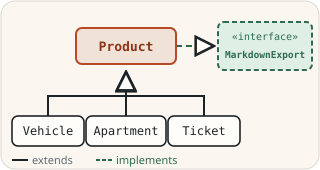
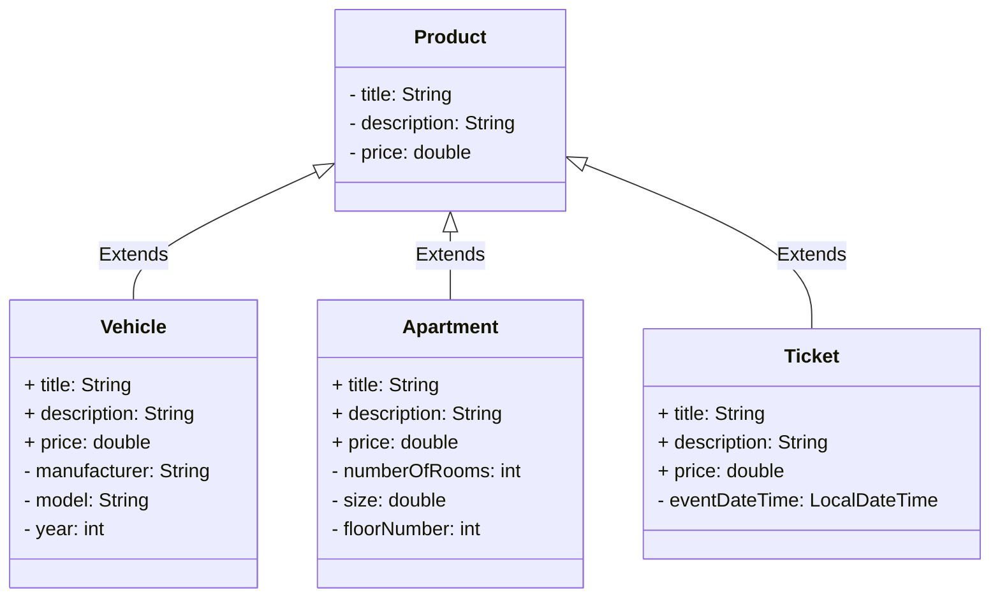

> [!NOTE]
> The English translation for this exercise can be found in [this file](./readme.en.md).

# Perintä ja rajapinnat



Tämä repositorio sisältää Java-harjoituksia, joiden avulla perehdyt perintään ja rajapintoihin. Suosittelemme seuraavia itseopiskelumateriaaleja, ja lisäksi sinun tulee etsiä tietoa itsenäisesti muistakin lähteistä:

* [Objects, Classes, Interfaces, Packages, and Inheritance (dev.java)](https://dev.java/learn/oop/)
* [Java Polymorphism Fully Explained In 7 Minutes (Coding with John, YouTube)](https://youtu.be/jhDUxynEQRI)
* [Super Keyword in Java Full Tutorial - How to Use "super" (Coding with John, YouTube)](https://www.youtube.com/watch?v=Qb_NUn0TSAU)

## Tehtävän aloittaminen

Forkkaa ensin tämä repositorio omaan GitHub-repositorioosi GitHubin **Fork**-painikkeella ja kloonaa vasta sitten oma forkkisi koneellesi:

```sh
git clone https://github.com/<oma-github-tunnuksesi>/5-inheritance-and-interfaces.git
```

Avaa kloonattu projekti koodieditorissasi.

## Testaaminen

Tehtävän osille on valmiit [JUnit](https://junit.org/)-yksikkötestit hakemistossa [src/test/java](./src/test/java/). Kunkin osan kohdalla kerrotaan, millä testiluokalla se arvioidaan. Voit ajaa testit koodieditorisi testaustyökalulla ([VS Code](https://code.visualstudio.com/docs/java/java-testing), [Eclipse](https://www.vogella.com/tutorials/JUnitEclipse/article.html)) tai [Gradlella](https://docs.gradle.org/current/userguide/java_testing.html), esimerkiksi:

```
./gradlew test --tests ProductTest        # unix
.\gradlew.bat test --tests ProductTest    # windows
```

Lisää komennon loppuun `--info`, jos haluat tarkemmat tiedot epäonnistuneista testeistä. Testien tekniseen toteutukseen ei tarvitse perehtyä, ja voit kokeilla ratkaisuasi myös omalla `main`-metodilla. Saat kirjoittaa omia testejä lisää, mutta älä muuta tai poista valmiita testejä.

Älä muuta valmiiden luokkien, metodien ja konstruktorien nimiä, parametreja tai paluuarvojen tyyppejä, sillä silloin testit eivät käänny. Saat tiedoston alkuperäisen version takaisin komennolla `git restore <tiedoston polku>` tai kurssijärjestelmän **Palauta lähtökoodi** -toiminnolla.

## Palauttaminen ja pisteet

Jokaisella tehtävän osalla on kurssijärjestelmässä (https://jtjuslin.kapsi.fi/java) oma sivunsa, jonka koodikentissä on osan koodipohja. Kopioi ratkaisusi koodikenttiin tai kirjoita se suoraan niihin. **Testaa ilman palautusta** ajaa osan testit tallentamatta pisteitä, ja **Lähetä** palauttaa ratkaisun. Jokainen testiluokka hyväksytään vain, jos sen kaikki testit menevät läpi, ja pisteet jaetaan hyväksyttyjen testiluokkien mukaan.

**Pisteet kahdessa vaiheessa**

1. Kun ratkaisusi menee läpi kurssijärjestelmässä, saat osasta **puolet pisteistä**.
2. Pushaa lopuksi kaikki julkiseen GitHub-repositorioosi. Paina tämän jälkeen osan sivulla **Lähetä tarkistettavaksi** -nappia. Kun testit menevät läpi, saat osasta **täydet pisteet**. Repositorio saa jäädä julkiseksi.

GitHubissa ei ole arvioivaa YAML-tehtävävirtaa (GitHub Actions -workflowta), eikä `git push` käynnistä arviointia. Kun painat **Lähetä tarkistettavaksi**, kurssijärjestelmän botti hakee koodisi repositoriostasi ja tarkistaa sen samoilla testeillä. Molemmat vaiheet pitää tehdä ennen luvun määräaikaa. Voit lähettää ratkaisusi niin monta kertaa kuin tarvitset, ja voimaan jää paras tulos.


## Osa 1: perintä *(perusteet, 10 % + 10 %)*

Paketin [inheritance.webshop](./src/main/java/inheritance/webshop/) neljä luokkaa mallintavat kuvitteellisen verkkokaupan tuotteita. Kaikilla tuotteilla on [Product](./src/main/java/inheritance/webshop/Product.java)-luokassa määritellyt tiedot (title, description, price). [Ajoneuvoilla](./src/main/java/inheritance/webshop/Vehicle.java), [asunnoilla](./src/main/java/inheritance/webshop/Apartment.java) ja [pääsylipuilla](./src/main/java/inheritance/webshop/Ticket.java) on omat aliluokkansa, joissa on juuri niille ominaisia lisätietoja:



Toteuta ensin `Product`-luokka sen kommenttien mukaisesti. Kun se toimii, toteuta `Vehicle`-luokka, joka perii `Product`-luokan. `Apartment`- ja `Ticket`-luokat ovat niin samankaltaisia kuin `Vehicle`, että niitä ei testata eikä arvioida: voit jatkaa perinnän harjoittelua niiden parissa itsenäisesti.

Arvioinnissa ajetaan testiluokat [ProductTest](./src/test/java/inheritance/webshop/ProductTest.java) (puolet pisteistä) ja [VehicleTest](./src/test/java/inheritance/webshop/VehicleTest.java) (puolet pisteistä).


## Osa 2: monimuotoisuus *(soveltava, 20 %)*

Aliluokkien olioita voidaan käyttää yliluokan olioiden paikalla esimerkiksi kokoelmissa tai metodien parametreina. Täydennä [WebShop](./src/main/java/inheritance/webshop/WebShop.java)-luokan metodit, joissa harjoitellaan eri tyyppisten olioiden käyttämistä yhdessä ja sen tunnistamista, minkä luokan oliosta on kulloinkin kyse.

Tämä osa käyttää osassa 1 toteuttamiasi `Product`- ja `Vehicle`-luokkia, joten varmista ensin, että ne toimivat. Kurssijärjestelmä tuo ne tähän osaan automaattisesti, kun avaat sen ensimmäisen kerran.

Arvioinnissa ajetaan testiluokka [WebShopTest](./src/test/java/inheritance/webshop/WebShopTest.java).


## Osa 3: Comparable-rajapinta *(perusteet, 20 %)*

[Country](./src/main/java/interfaces/country/Country.java)-luokka mallintaa maita ja niiden väkilukuja. Muuta luokka toteuttamaan Javan valmis [`Comparable<Country>`](https://docs.oracle.com/en/java/javase/21/docs/api/java.base/java/lang/Comparable.html)-rajapinta ja toteuta sen ainoa metodi `compareTo` luokan kommenttien sääntöjen mukaisesti. Voit kokeilla ratkaisuasi valmiilla [CountryMain](./src/main/java/interfaces/country/CountryMain.java)-pääohjelmalla.

Arvioinnissa ajetaan testiluokka [CountryTest](./src/test/java/interfaces/country/CountryTest.java).


## Osa 4: oman rajapinnan toteuttaminen *(soveltava, 10 % + 10 %)*

**MarkdownExport-rajapinta.** Määrittele tiedostoon [MarkdownExport.java](./src/main/java/interfaces/markdown/MarkdownExport.java) oma rajapinta `MarkdownExport`, jossa on yksi metodi: `exportMarkdown()`. Metodilla ei ole parametreja, ja se palauttaa merkkijonon. Rajapinnan toteuttavat luokat muodostavat metodilla oliosta [markdown](https://www.markdownguide.org/)-muotoisen esityksen esimerkiksi tiedostoon tallentamista varten. Markdown-syntaksia ei tarvitse tuntea, kun seuraat alla olevia esimerkkejä.

**Pizza-luokka.** Muuta valmis [Pizza](./src/main/java/interfaces/markdown/Pizza.java)-luokka toteuttamaan rajapinta. Pizzan markdown-esityksessä on oltava nimi otsikkona (`# nimi`), täytteet listana (`- täyte`) ja lopussa hinta, esimerkiksi:

```md
# Hawaiian

Toppings:
- ham
- pineapple
- mozarella

Price: 10.90
```

**Product-luokka.** Muuta lopuksi osan 1 [Product](./src/main/java/inheritance/webshop/Product.java)-luokka toteuttamaan rajapinta. Tuotteen markdown-esityksessä on oltava nimi, kuvaus ja hinta, mutta muuten muodon saa valita vapaasti. Koska `Product` on eri paketissa kuin rajapinta, lisää siihen rivi `import interfaces.markdown.MarkdownExport;`.

💡 *Koska `Vehicle` perii `Product`-luokan, myös se toteuttaa rajapinnan automaattisesti. Voit halutessasi antaa ajoneuvoille oman `exportMarkdown`-toteutuksen.*

Arvioinnissa ajetaan testiluokat [MarkdownExportTest](./src/test/java/interfaces/markdown/MarkdownExportTest.java) (rajapinta ja `Pizza`) ja [ProductMarkdownTest](./src/test/java/interfaces/markdown/ProductMarkdownTest.java) (`Product`).


## Osa 5: "dependency injection" *(edistynyt, 20 %)*

Viimeinen osa on perintää soveltava "dependency injection" -esimerkki:

> *"In software engineering, dependency injection is a programming technique in which an object or function receives other objects or functions that it requires, as opposed to creating them internally. Dependency injection aims to separate the concerns of constructing objects and using them, leading to loosely coupled programs"*
>
> Dependency injection. Wikipedia. https://en.wikipedia.org/wiki/Dependency_injection

Ratkaisu vaatii vain pienen muutoksen. Tärkeintä on perehtyä annettuihin luokkiin ja niiden kommentteihin:

* [Main](./src/main/java/dependency_injection/Main.java): tehtävänanto on tämän luokan kommenteissa, ja tämä on ainoa luokka, jota muutetaan.
* [Application](./src/main/java/dependency_injection/Application.java)
* [PrinterWithTimestamp](./src/main/java/dependency_injection/PrinterWithTimestamp.java)

Muuta `Main`-luokkaa niin, että se luo `PrinterWithTimestamp`-olion, antaa sen uudelle `Application`-oliolle ja kutsuu tämän `run()`-metodia. Kokeile ohjelmaa suorittamalla `Main`-luokka koodieditorissasi tai komennolla `./gradlew run` (Windowsissa `.\gradlew.bat run`) ja tutki sen tulostetta.

Arvioinnissa ajetaan testiluokka `DependencyInjectionTest`, joka ajaa `Main`-luokan ja tarkistaa, että sovelluksen kaikki rivit tulostuvat aikaleiman kanssa. Testi ei ole tässä repositoriossa.


## Lisenssi ja tekijät

Tämän tehtävän ovat kehittäneet Teemu Havulinna ja Jukka Juslin, ja se on lisensoitu [Creative Commons BY-NC-SA -lisenssillä](https://creativecommons.org/licenses/by-nc-sa/4.0/). Tehtävänannon, lähdekoodien ja testien toteutuksessa on hyödynnetty ChatGPT 3.5 -kielimallia sekä GitHub Copilot -tekoälyavustinta.
